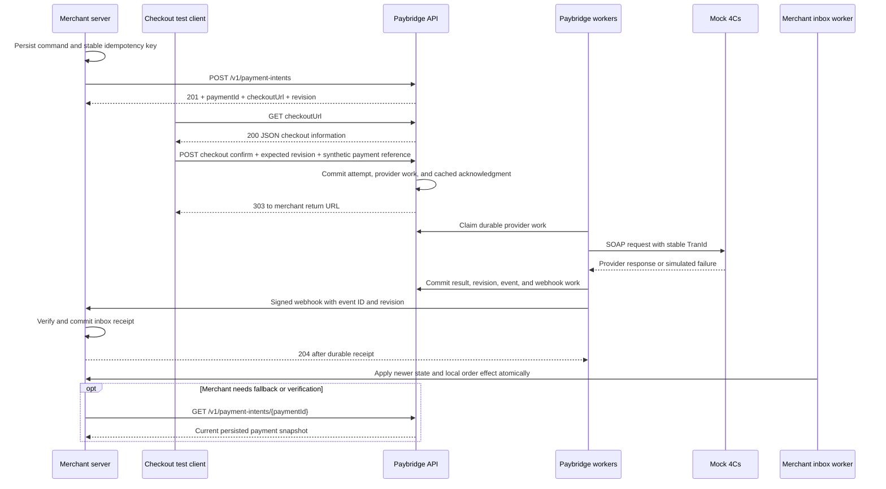
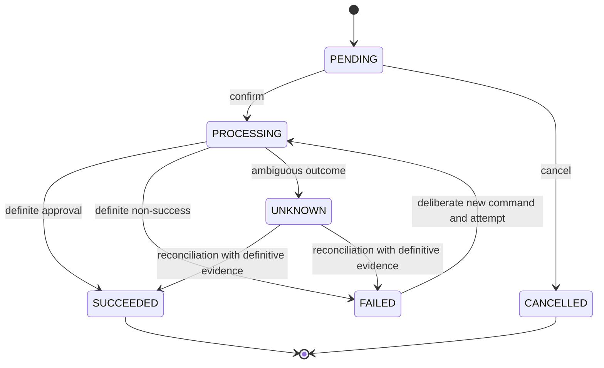

# Paybridge TypeScript reference implementation specification

**Status:** Approved reference contract, accompanying the ready-for-agent specification  
**Updated:** 2026-10-11  
**Purpose:** Define the protocol, behavior, state/data models, and failure handling for a local TypeScript proof of concept before implementation.

This revision retains the supplied Draft 2 architecture and confirmed stack, incorporates the owner's decisions, and clarifies the failure evidence the prototype must demonstrate. The owner approved this consolidated plan. Section 22 distinguishes accepted behavior changes from clarifications of existing requirements. The [published specification](spec.md) presents the agreed scope in the issue-tracker template. [Review history](review.md) records the interview and source references.

## 1. Goal

Build a small TypeScript reference implementation of Paybridge that makes the agreed payment protocol and reliability guarantees visible and testable on both the service and consumer sides.

Demonstrate merchant commands, durable payment intents and attempts, idempotency, provider recovery, uncertain outcomes, manual reconciliation, signed webhooks, a durable merchant inbox, authoritative status lookup, and payment lifecycle history. Keep the payment rules and integration boundaries explicit. A later Go implementation is possible, but cross-language portability work is not part of this prototype.

This is a local MVP using synthetic payments. It demonstrates payment behavior and API shape without a UI or live 4Cs connection. It does not establish production readiness or exactly-once delivery across services.

The intended product provides hosted checkout for independent merchants in Anguilla using their own NCBA/4Cs merchant keys. This prototype uses seeded merchants and synthetic credentials to demonstrate that account boundary. Self-service onboarding belongs to the later product. Hosted checkout can reduce merchant card-data handling; it does not transfer every merchant compliance responsibility to Paybridge. See the [PCI SSC outsourcing guidance](https://www.pcisecuritystandards.org/faqs/does-pci-dss-apply-to-merchants-who-outsource-all-payment-processing-operations-and-never-store-process-or-transmit-cardholder-data/).

## 2. First implementation scope

The reference implementation contains three separate TypeScript applications in one repository:

| Component       | MVP responsibilities                                                                                                                                                          | Persistence          |
| --------------- | ----------------------------------------------------------------------------------------------------------------------------------------------------------------------------- | -------------------- |
| Paybridge       | Merchant API, checkout protocol routes, payment rules, 4Cs adapter, reconciliation commands, provider and webhook workers                                                     | `paybridge.sqlite`   |
| Sample merchant | Create and confirm payments, persist command keys and local payment records, receive signed webhooks, process its inbox, handle return navigation, perform fallback lookup    | `merchant.sqlite`    |
| Mock 4Cs        | Local SOAP transaction endpoint, durable transaction identity, deterministic approval, decline, incomplete, timeout, lost-response, duplicate, and delayed-response scenarios | `mock-fourcs.sqlite` |

Each application owns its database. The merchant calls Paybridge over HTTP; Paybridge calls the mock over HTTP. Shared database reads must not replace these service boundaries. Test harnesses may inspect the mock ledger as evidence for a simulated reconciliation.

The confirmed stack is TypeScript, Fastify, Prisma ORM 8, SQLite, ArkType, `@fastify/swagger`, Vitest, and Bun as package manager. Section 20 explains the small remaining implementation choices.

### Checkout without a UI

Retain `checkoutUrl`, checkout display/confirm/leave routes, browser return, and `303 See Other`. Leaving checkout is navigation only; the merchant API owns permanent cancellation. Demonstrate them with HTTP clients and tests. The display route returns JSON checkout information; confirmation uses a synthetic `mockPaymentMethodRef`. No card-entry page, merchant results page, dashboard, or other UI is required.

The server-to-server confirm endpoint remains in this MVP, as previously agreed, to demonstrate the protocol. Its production inclusion remains a later decision.

### Out of scope for this prototype

- live 4Cs connectivity, bank certification, and real card collection
- UI implementation, including checkout, merchant, treasury, and administration screens
- refunds, partial captures, separate authorization/capture, subscriptions, and repeat charges
- additional providers beyond the existing 4Cs adapter boundary
- self-service signup, provider-key submission, credential rotation workflows, and multiple webhook endpoints per merchant
- replacement payment intents for the same sample order after explicit merchant cancellation
- production PCI certification, production secret infrastructure, and final deployment architecture
- predecessor API compatibility work
- a message broker, distributed worker platform, or hosted queue

These exclusions preserve the stated prototype boundary. Existing payment, recovery, notification, checkout protocol, and reconciliation capabilities remain in the MVP.

## 3. Core concepts

| Concept          | Meaning                                                                                                             |
| ---------------- | ------------------------------------------------------------------------------------------------------------------- |
| `Merchant`       | A person or organisation collecting payments using its own provider merchant account, with an integrating application and one configured webhook destination. |
| `PaymentIntent`  | A request to collect a fixed amount for a business obligation.                                                      |
| `PaymentAttempt` | One financial attempt, with one stable provider transaction ID.                                                     |
| `PaymentEvent`   | Append-only lifecycle history; this is not event sourcing.                                                          |
| `Reconciliation` | Investigation and resolution of one `UNKNOWN` attempt.                                                              |
| `IdempotencyKey` | Durable identity and cached response for one merchant or checkout command.                                          |
| `ProviderOutbox` | Durable work to submit or recover the same attempt after a crash.                                                   |
| `WebhookOutbox`  | Durable delivery of a payment event; delivery failure never changes its financial result.                           |
| `MerchantInbox`  | Merchant-owned durable receipt and processing record, unique by Paybridge event ID.                                 |
| `Revision`       | Increasing per-payment state version, allowing webhook and lookup consumers to reject stale snapshots.              |

The [project glossary](../../GLOSSARY.md) distinguishes the merchant from its application. The application owns its business order-to-intent binding and reuses that intent across interrupted checkout and failed attempts. `merchantReference` is descriptive business context, not a Paybridge uniqueness constraint across intents; different intents can represent the same reference, so order-level duplicate protection remains the merchant application's responsibility.

## 4. High-level payment flow



The merchant API can confirm directly instead of using the checkout route. Both paths use the same internal operation. The return and webhook can arrive in either order; a redirect is never proof of payment. The webhook is the primary notification, while lookup supplies fallback, recovery, and verification.

## 5. Payment state model

### Payment statuses

```text
PENDING
PROCESSING
SUCCEEDED
FAILED
UNKNOWN
CANCELLED
```



| Status       | Meaning                                                                          |
| ------------ | -------------------------------------------------------------------------------- |
| `PENDING`    | No financial attempt has started.                                                |
| `PROCESSING` | One attempt exists and is being submitted or recovered.                          |
| `SUCCEEDED`  | Definitive evidence establishes success. Terminal for this payment intent.           |
| `FAILED`     | Definitive evidence establishes non-success. A deliberate new attempt may start. |
| `UNKNOWN`    | The financial outcome is uncertain. A fresh attempt is blocked.                  |
| `CANCELLED`  | Explicit merchant cancellation before financial processing. Terminal.                  |

### Required invariants

1. `UNKNOWN` is not `FAILED`; cancellation is not a provider error.
2. At most one `PROCESSING` or `UNKNOWN` attempt exists per intent. Different command keys do not bypass this rule.
3. Recovery reuses the same attempt, durable mock input, and provider `TranId`.
4. A deliberate new attempt after definite failure uses the current payment revision, a new command key, and a new `TranId`.
5. A replay of an earlier command never starts a new attempt, even after that attempt fails.
6. `SUCCEEDED` and `CANCELLED` are terminal. Only `PENDING` can be cancelled.
7. Browser return and webhook delivery do not change Paybridge financial state.
8. State transitions use transactional guards. A stale worker cannot overwrite a settled or reconciled result.
9. The intent starts at revision `1`; each committed status change increments its revision atomically. Event snapshots and lookup responses carry that revision.
10. Revisions determine freshness; status names and timestamps do not. `FAILED -> PROCESSING` is a valid newer state.
11. Every new confirmation checks `expectedRevision` atomically with state and attempt creation. Identical completed command replay precedes this check.
12. Leaving checkout changes no payment state. The sample does not replace an explicitly cancelled intent for the same order.
13. One merchant's provider submission, recovery, and reconciliation always use that merchant's bound provider account.
14. Inconclusive evidence leaves `UNKNOWN` unresolved. No timeout, missing record, or operator assertion by itself establishes definite non-payment.

## 6. 4Cs provider rules and mock fidelity

The supplied FMX SSIS Revision 2.2 guide describes `SSISProcessTransaction`, a SOAP 1.1 operation. The MVP mock implements that operation's request/response shape and the relevant failure behavior. It uses synthetic fixtures and a local endpoint, not an actual provider account.

### Request mapping

| Provider field       | MVP rule                                                                                                                                                                                                             |
| -------------------- | -------------------------------------------------------------------------------------------------------------------------------------------------------------------------------------------------------------------- |
| `MerchantKey`        | Server-only synthetic credential for the owning merchant's bound provider account, distinct from its Paybridge API key.                                                                                                                          |
| `TranType`           | `AuthAndPost`; definite approval establishes the prototype success threshold of authorization and posting, not completed settlement.                                                                                                                                               |
| `TranId`             | Stable alphanumeric ID, 1-16 characters, unique per attempt. The SOAP template uses `TranId`.                                                                                                                        |
| `Invoice`            | Stable alphanumeric provider reference, 1-16 characters, persisted on the intent. Do not blindly truncate or pass through `merchantReference`, which may include punctuation.                                        |
| `Amount`, `Currency` | Convert integer minor units to the documented two-decimal provider format without floating-point money arithmetic. Validate supported currency metadata and provider limits. XCD supplies the initial demo fixtures. |
| Card fields          | Resolve only synthetic fixture values inside the adapter from `mockPaymentMethodRef`; no real card details are collected, persisted, or returned to the merchant.                                                    |

### Response layers

Interpret the outer `SSISProcessTransactionResult`, then the response `ResultCode`, then `FinancialResultCode`. An HTTP `200` or either service-level `OK` is not itself approval. Financial result codes are meaningful only when the operation and response result permit financial interpretation.

| 4Cs outcome                                                                                                       | Paybridge result                                                                                                               |
| ----------------------------------------------------------------------------------------------------------------- | ------------------------------------------------------------------------------------------------------------------------------ |
| Outer operation `OK`, `ResultCode = OK`, financial `Approved`                                                     | `SUCCEEDED`                                                                                                                    |
| Outer operation `OK`, `ResultCode = OK`, financial `Declined`                                                     | `FAILED`                                                                                                                       |
| Outer operation `OK`, `ResultCode = OK`, financial `Incomplete`                                                   | `FAILED`, preserving the distinct provider code; the guide treats this as payment unavailable at that time, not a bank decline |
| Timeout, lost connection, malformed response, mismatched echoed identifiers/amount, or unproven financial outcome | `UNKNOWN`                                                                                                                      |
| Same-ID recovery reaches an operation the mock has not previously accepted                                        | Process it once and apply its definitive response                                                                              |
| Same-ID recovery reaches an already recorded transaction                                                          | `DuplicateTransaction`; keep `UNKNOWN` and require reconciliation                                                              |

Missing informational response fields are null. Preserve useful non-sensitive references, including `HostReference`, when present. Other error codes become `FAILED` only when the response proves final non-payment for the whole attempt, including any overlapping or delayed same-ID submissions; otherwise use `UNKNOWN`. A rejection of one submission is insufficient if another could still execute. Do not infer success from an arbitrary financial field accompanying a non-`OK` result.

### Durable mock behavior

The mock has a unique transaction ledger keyed by its provider account and `TranId`. Atomically record an accepted transaction and its final simulated outcome before intentionally losing or delaying its response. That outcome is immutable. Every submission path, including concurrent and delayed submissions after restart, honors the same ledger and cannot create another simulated financial effect for that identity. If a simulated pre-acceptance failure leaves no recorded transaction, a later same-ID submission may process normally. Consequently, an absent row is not proof of non-payment.

This durable account-scoped deduplication is an explicit mock assumption. The supplied guide requires unique transaction identifiers and describes duplicate errors, but does not establish the live provider's identity namespace, retention, concurrent execution, or failover durability. The prototype demonstrates correctness under its stated mock contract; live recovery requires separate evidence. Paybridge continues generating globally unique provider transaction IDs, which avoids relying on account-scoped reuse.

Seed two merchants with distinct synthetic provider accounts, Paybridge API credentials, webhook secrets, and destinations. Bind a provider account to each merchant through server-owned fixture configuration; the caller cannot choose another account in a payment request. The sample application may host both fixture merchants with isolated order and payment bindings. Do not add a fourth application or account-management workflow.

Scenario selection is controlled through synthetic fixture references and test configuration; it is not a proposed production payment API. Keep any simulated operator lookup separate from the SOAP payment operation.

`SSISProcessTransactionRepeat` authorizes a new transaction using a prior host reference. It is not a status lookup or crash-recovery primitive and is not called by MVP recovery. The old guide's transport recommendations do not prescribe the prototype's security settings; local synthetic HTTP and future live transport are separate concerns.

## 7. Recovery and reconciliation

### Provider recovery

Confirmation commits the command acknowledgment, attempt, safe mock input, payment transition, event, and provider outbox item before any network call. The API does not submit the provider request; the provider worker handles all submissions in this MVP.

If a worker crashes before sending, reclaim its expired work and submit the same attempt and `TranId`. If it crashes after sending but before saving a response, reclaim and resubmit the same attempt and `TranId`. A normal definitive response resolves it; a duplicate or ambiguous result produces `UNKNOWN` and one reconciliation record. Reclaiming work may overlap an earlier suspended sender. The local claim protects state updates, while the mock's durable transaction identity protects its simulated financial effect.

Once `UNKNOWN` is committed, complete the provider work item and stop automatic financial submissions. A transport timeout is not a reason to generate a new transaction ID. Recovery of abandoned `PROCESSING` work and investigation of committed `UNKNOWN` outcomes are separate operations.

The durable synthetic reference makes restart demonstrations possible without storing raw card data. It does not claim that real 4Cs supplies tokenization or a transaction lookup API. Real card-data recovery design remains part of a later live integration.

### Manual reconciliation

States remain `REQUIRED`, `IN_PROGRESS`, and `RESOLVED`, with one row per unknown attempt. No row means no reconciliation is required.

Provide local commands to list required cases, start an investigation, and resolve it with `SUCCEEDED` or `FAILED`. They call the same application services as the workers, validate current state, and record operator identity, time, resolution, reason, and any notes or external reference. No operator UI or new administration API is needed.

For demonstrations, the operator inspects the mock ledger as independent provider evidence. Bind the evidence to the exact provider account, `TranId`, invoice, amount, and currency. A final stored approval supports success; a final stored decline or the selected definitive incomplete fixture supports failure. An absent row, missing webhook, redirect, expired timer, or free-form note alone supports neither resolution. The record must also prevent a delayed same-ID submission from creating a different financial outcome.

The operator can inspect or export sanitized fixture evidence and submit it to the local reconciliation command without giving Paybridge workers access to the mock database. This is a synthetic demonstration of a trusted operator's verification, not a live lookup API or a cryptographic attestation system. Retain the evidence reference and sanitized facts with the resolution. If evidence is inconclusive, leave the investigation open and the attempt `UNKNOWN`; do not invent a mock closure operation.

Guard resolution against duplicate or conflicting concurrent commands. Repeating the same resolution is a no-op; an incompatible second resolution is rejected.

Resolution atomically updates attempt and intent, increments the revision, resolves the reconciliation, appends history, and creates the corresponding webhook. A fresh attempt remains blocked until resolution establishes `FAILED`.

### Late provider observations

A stale worker cannot change financial state, but a response it receives may still matter to the operator. Preserve a bounded, sanitized observation in append-only payment history, including the exact attempt, provider account, transaction ID, response classification, useful provider reference, and observation time. Recording it does not change the payment status, increment its revision, or create a financial webhook. An unknown attempt still requires the existing manual reconciliation flow. A contradictory observation on a resolved attempt produces an actionable diagnostic and remains available for investigation; this prototype does not add a workflow for rewriting resolved financial decisions.

## 8. Merchant API contract

### Authentication, validation, and errors

Merchant routes require `Authorization: Bearer <merchant-key>`. The key stays server-side; every command and read is scoped to its authenticated merchant. Return `404` for an absent payment or one owned by another merchant.

Requests and responses use `application/json`. ArkType validates bodies, parameters, and relevant headers. Reject unsupported fields, non-integer or out-of-range amounts, invalid currency codes, and invalid URLs. Bound strings and request sizes in the route schemas. A missing or invalid required idempotency key is `400`.

All JSON errors use this shape:

```json
{
    "error": {
        "code": "payment_not_confirmable",
        "message": "The payment cannot be confirmed in its current state.",
        "requestId": "req_..."
    }
}
```

Common errors include `invalid_request`, `invalid_idempotency_key`, `unauthorized`, `payment_not_found`, `idempotency_conflict`, `command_in_progress`, `payment_not_confirmable`, `payment_revision_conflict`, `payment_not_cancellable`, `temporarily_unavailable`, and `internal_error`. Do not return stack traces, credentials, or raw provider payloads. A provider decline or unknown outcome is payment state, not an HTTP server failure.

### Payment snapshot

Lookup and cancellation return the same public snapshot shape. Creation adds a checkout URL. `latestAttempt` is null before an attempt exists; otherwise it contains only its ID, number, status, and optional non-sensitive failure code.

```json
{
    "id": "pi_...",
    "merchantReference": "REG-2026-00124",
    "amount": 7500,
    "currency": "XCD",
    "status": "SUCCEEDED",
    "revision": 3,
    "createdAt": "2026-10-11T12:00:00Z",
    "updatedAt": "2026-10-11T12:00:01Z",
    "latestAttempt": {
        "id": "pa_...",
        "attemptNumber": 1,
        "status": "SUCCEEDED"
    }
}
```

Amount, currency, business reference, and return URL are fixed at creation in this MVP. Provider invoice and transaction references remain internal.

### Create payment intent

```http
POST /v1/payment-intents
Authorization: Bearer <merchant-key>
Idempotency-Key: <stable-create-key>
Content-Type: application/json
```

```json
{
    "merchantReference": "REG-2026-00124",
    "amount": 7500,
    "currency": "XCD",
    "description": "Nursing registration",
    "returnUrl": "https://merchant.example/payment-return"
}
```

`amount` is a positive safe integer in minor units, within the adapter's accepted limits. Currency support and its minor-unit metadata must be explicit in the fixtures and OpenAPI schemas. The return URL must belong to the merchant's configured return origin; localhost HTTP is permitted for local fixtures. This prevents an arbitrary redirect destination without adding an administration workflow.

Return `201 Created`, a `Location` header pointing to the merchant lookup route, and the snapshot with `PENDING`, revision `1`, null `latestAttempt`, and `checkoutUrl`:

```json
{
    "id": "pi_...",
    "merchantReference": "REG-2026-00124",
    "amount": 7500,
    "currency": "XCD",
    "status": "PENDING",
    "revision": 1,
    "createdAt": "2026-10-11T12:00:00Z",
    "updatedAt": "2026-10-11T12:00:00Z",
    "latestAttempt": null,
    "checkoutUrl": "https://paybridge.example/checkout/pi_...?token=..."
}
```

Creation and its cached response commit together. The exact cached body contains the usable checkout token even though the separate authorization column stores its hash. Treat this cached response as sensitive local payment data, exclude it from logs and diagnostics, and preserve it only with the prototype payment records. The synthetic prototype does not claim that its database contains only token hashes or add production secret infrastructure. A valid replay returns the original `201` response, even if the payment has subsequently changed. Lookup returns current state.

### Retrieve payment intent

```http
GET /v1/payment-intents/{paymentId}
Authorization: Bearer <merchant-key>
```

Return `200` with the current persisted snapshot and `Cache-Control: no-store`. This is authoritative Paybridge state; it does not query 4Cs during the request. `UNKNOWN` remains a valid lookup result.

### Confirm payment intent

```http
POST /v1/payment-intents/{paymentId}/confirm
Authorization: Bearer <merchant-key>
Idempotency-Key: <stable-confirm-key>
Content-Type: application/json
```

```json
{
    "mockPaymentMethodRef": "pm_mock_approved",
    "expectedRevision": 1
}
```

The synthetic reference resolves to a controlled fixture. It is an MVP-only input, not a claim about real provider tokens. A new command is permitted only from `PENDING` or `FAILED`, only if no unresolved attempt exists, and only if the required positive safe integer `expectedRevision` matches the current stored revision. Apply all three guards atomically with attempt creation. An identical completed command returns its cached result before these current-state checks; changed input under the same key remains an idempotency conflict. Missing or invalid `expectedRevision` is `400`; a valid new command based on an old revision is `409 payment_revision_conflict` and creates no attempt or provider work.

Return `202 Accepted` after committing the specific attempt and provider work. Set `Location` to the lookup route. The acknowledgment is a snapshot at acceptance:

```json
{
    "paymentIntentId": "pi_...",
    "paymentAttemptId": "pa_...",
    "attemptNumber": 1,
    "status": "PROCESSING",
    "revision": 2,
    "statusUrl": "https://paybridge.example/v1/payment-intents/pi_..."
}
```

The worker may already finish before the client receives this acknowledgment. Replays return this same cached acknowledgment; clients use lookup or webhooks for current state. Thus command completion means durable acceptance, and does not mean financial completion. After definite failure, an explicit confirmation with a new key and the failed payment's current revision can start the next attempt. On a revision conflict, the caller refreshes its view and obtains a deliberate new confirmation. It must not automatically refresh and resubmit the stale instruction as a new attempt.

### Cancel payment intent

```http
POST /v1/payment-intents/{paymentId}/cancel
Authorization: Bearer <merchant-key>
```

Only the authenticated merchant performs permanent cancellation. Atomically change only `PENDING -> CANCELLED`, increment revision, append history, and enqueue the cancellation webhook. Return `200` with the snapshot. Repeating cancellation on an already cancelled payment returns the unchanged snapshot without another event. Other states return `409`.

### Status code summary

| Operation | Success | Expected errors                                                                       |
| --------- | ------- | ------------------------------------------------------------------------------------- |
| Create    | `201`   | `400` invalid input/key, `401` authentication, `409` key conflict/in-progress command |
| Retrieve  | `200`   | `400` malformed identifier, `401`, `404`                                              |
| Confirm   | `202`   | `400`, `401`, `404`, `409` key conflict, outdated revision, or unacceptable state                         |
| Cancel    | `200`   | `400`, `401`, `404`, `409` unacceptable state                                         |

All routes may return `503` for temporary database unavailability or `500` for an unexpected internal error, using the standard error shape. A failed or lost HTTP response does not establish whether a command committed; retry create/confirm with the original key.

Generate OpenAPI from the actual Fastify route schemas and include every request, response, header, and error shape above. Serve or export `/openapi.json`; an interactive documentation UI is not required.

## 9. Checkout protocol without a UI

These routes preserve the agreed future hosted-checkout boundary while allowing a headless demonstration. A payment ID alone is not checkout authorization: creation generates a random checkout capability, stores its authorization hash, and returns it in `checkoutUrl`. Its exact cached create response also retains the usable token as described in section 8. The client sends that token on checkout requests. Invalid capabilities return a generic `404`; tokens are not merchant API credentials and are not logged.

### Display checkout information

```http
GET /checkout/{paymentId}?token=<checkout-token>
```

Return `200` JSON containing `paymentIntentId`, `amount`, `currency`, `status`, `revision`, and confirm/leave route paths. Permit display for `PENDING` or `FAILED`; return `409` when the payment cannot currently be paid. No HTML or card-entry form is implemented.

### Confirm checkout

```http
POST /checkout/{paymentId}/confirm?token=<checkout-token>
Idempotency-Key: <stable-checkout-command-key>
Content-Type: application/json
```

The body is the same synthetic input as merchant confirmation. Call the shared confirmation service and commit the attempt, provider work, and cached checkout acknowledgment. Return:

```http
303 See Other
Location: <registered-returnUrl-with-paymentId>
```

Use a URL builder to preserve existing query parameters and encode the payment ID. The `303` occurs after durable acceptance, while financial state may still be `PROCESSING`. The redirected `GET` is navigation only. Idempotent replays return the original `303` and `Location` without another attempt.

### Leave checkout

```http
POST /checkout/{paymentId}/leave?token=<checkout-token>
```

Validate the checkout capability and return `303` to the registered merchant return URL. This is navigation only in every payment state. It does not cancel an intent, stop provider work, create a payment attempt, advance a revision, or emit a financial event or webhook. Repeated navigation is harmless and needs no command key.

The old proposed checkout `/cancel` route is not implemented. Permanent cancellation remains on the authenticated merchant API and is allowed only from `PENDING`. A payer who leaves while processing or unknown can return to the merchant, but the existing state guards continue to prohibit a new payment attempt.

Checkout confirmation errors use the same JSON error shape, including `409 payment_revision_conflict`. Invalid requests/keys are `400`, inaccessible payments are `404`, invalid states/key conflicts are `409`, and temporary/unexpected service failures are `503`/`500`. The leave route does not reject navigation merely because the payment is in a terminal or unresolved state.

## 10. Merchant return and consumer behavior

The sample merchant return route is `GET /{merchantFixture}/payment-return?paymentId=...`. The seeded fixture route identifies the receiving merchant context; the payment ID must match an order/payment binding owned by that merchant. Return a generic `404` for an absent or differently owned binding. The response is a small JSON result for the demo instead of a rendered page, and the parameter never marks an order paid. These local fixture routes do not introduce a production merchant-login system.

Use a webhook-updated final local snapshot when available. If local state is incomplete or the return arrives first, perform Paybridge lookup using that receiving merchant's server-side API credential. Apply the returned snapshot using the same revision and ownership checks as inbox processing. Lookup may legitimately report `PROCESSING` or `UNKNOWN`.

The merchant persists its create/confirm command and key before sending HTTP. If a response is lost, resend the same command with the same key, including after restart. Store the returned payment binding before confirming it. Do not create a new intent or key automatically because a response was lost.

### Merchant inbox transaction rules

1. Identify the receiving merchant from the seeded webhook destination and use only its configured signing secret. Receive the raw body, validate its signature/timestamp and schema, and confirm matching header/payload event identity. Never choose a secret or owner from an untrusted payload field.
2. Commit one durable inbox receipt per event ID, including the authenticated receiving merchant context, payment ID, revision, exact payload, and receipt time. Only then return `204`.
3. A verified duplicate of the same event returns `204`; it creates no second work item. The same ID with different bytes or a different receiving merchant is a conflict requiring investigation.
4. The inbox worker claims pending receipts. Require the receipt's receiving merchant to match the owner of its local payment and order bindings, then validate amount, currency, and business reference. Use only that merchant's credential for any Paybridge lookup. Keep unmatched or conflicting bindings pending with an actionable diagnostic; never apply them to another merchant's order.
5. In one merchant database transaction, apply a newer snapshot, perform the local order-paid effect when appropriate, and mark the inbox receipt processed. Retry after a crash without a second effect.
6. Older or equal revisions are acknowledged and recorded as processed without overwriting newer local state or repeating the order effect.

The receipt must survive a crash after acknowledgment. A crash before receipt commit produces no successful acknowledgment and allows redelivery. Unknown local bindings remain pending for recovery rather than being silently discarded.

The sample order-paid effect is a local database update. External fulfillment systems and notifications are not added; they would require their own reliability design later.

## 11. Webhook contract

### Configuration and delivery

Store one destination and signing secret per merchant. Seed them locally; the merchant does not supply `webhookUrl` per payment. The sample endpoints are `POST /api/webhooks/paybridge/{merchantFixture}`, with a distinct seeded destination and signing secret for each of the two fixture merchants.

```http
POST https://merchant.example/api/webhooks/paybridge/merchant-a
Content-Type: application/json
Paybridge-Event-Id: evt_...
Paybridge-Timestamp: <Unix-seconds>
Paybridge-Signature: v1=<lowercase-hex-hmac>
```

```json
{
    "id": "evt_...",
    "type": "payment.succeeded",
    "createdAt": "2026-10-11T12:00:01Z",
    "data": {
        "paymentIntentId": "pi_...",
        "merchantReference": "REG-2026-00124",
        "amount": 7500,
        "currency": "XCD",
        "status": "SUCCEEDED",
        "revision": 3
    }
}
```

Event types remain `payment.succeeded`, `payment.failed`, `payment.unknown`, and `payment.cancelled`. These are full payment state snapshots at the identified revision, not instructions to replay every prior transition.

### Signature construction

Use HMAC-SHA256 over the UTF-8 bytes of `<timestamp>.<raw-request-body>`, using the merchant's seeded signing secret. Compare decoded signatures in constant time after validating their lengths. Verify before reserializing or using body fields. Allow a configurable 300-second timestamp tolerance in the local demonstration and reject timestamps too far in the future as well as the past.

Retries reuse the exact stored payload bytes and event ID, but generate a current timestamp and signature for each HTTP attempt. An old event can therefore be legitimately redelivered without disabling timestamp verification. No secret rotation workflow is added.

The merchant returns `204` only after a verified durable inbox receipt; invalid schema/identity is `400`, invalid signature/timestamp is `401`, conflicting reuse of an event ID is `409`, and a failed receipt commit is `503` or `500`. Any `2xx` acknowledges receipt to Paybridge; all other outcomes retain pending delivery work.

### Delivery and ordering guarantees

- Delivery is at least once; duplicate receipt and processing must be safe.
- Payment state, revision, event, and webhook work commit atomically.
- Webhook retries never retry the financial payment and do not change its result.
- A merchant outage does not change a completed payment result.
- Delivery order is not guaranteed. Compare each snapshot's revision with `last_applied_revision` in a guarded merchant transaction.
- Do not wait for contiguous revision numbers: create and processing revisions do not have webhook types in this MVP.
- Webhook and status-lookup snapshots use the same revision rule. A delayed failure cannot undo a newer success; a newer `PROCESSING` snapshot can legitimately follow an earlier failure.

Example: revision `3` is `FAILED`; a deliberate new attempt produces revision `4` `PROCESSING` and revision `5` `SUCCEEDED`. If success `5` arrives before failure `3`, apply success and retain the old receipt without changing the paid order.

## 12. Idempotency rules and lifecycle

Keep a separate command table. Required keys apply to payment creation, merchant confirmation, and the headless checkout confirmation. A repeated cancellation is naturally idempotent and does not require a key in this MVP.

Store merchant ID, key, operation, normalized request hash, status, intent ID, exact attempt ID when applicable, and cached HTTP status/body/relevant headers. Keys are non-empty strings of at most 128 characters. The key identity remains `(merchant_id, key)`; using a key for another operation or payment conflicts.

Hash a canonical representation of the validated business input, command operation, HTTP method, and normalized route/payment ID. Include the synthetic payment-method reference and `expectedRevision` for confirmation; exclude tracing IDs, credentials, and transient transport details. Define this canonicalization once and use it for every replay.

### Lifecycle

1. Authenticate and validate without changing state.
2. Begin a short transaction; reserve or find the key. A completed same-request key returns its cached result before evaluating current payment state.
3. Changed input, operation, or target is `409 idempotency_conflict`. An observable unfinished same-request command is `409 command_in_progress` with `Retry-After: 1`; it never starts a second operation.
4. For a new key, apply the expected-revision guard for confirmation, make the domain changes, and cache the acknowledgment in the same transaction. Creation caches `201`; merchant confirmation caches `202`; checkout confirmation caches `303` and `Location`.
5. Commit the key as `COMPLETED` together with the intent/attempt and any durable work. If the transaction rolls back, the reservation and domain changes roll back together.

`IN_PROGRESS` represents work inside command acceptance; the normal MVP path does not commit a stranded reservation before its work or response exists. A process crash leaves either no committed command or a completed cached acknowledgment with durable work. Database contention returns a bounded temporary error so callers can retry the original key.

Provider outcomes, including `UNKNOWN`, are independent of this acknowledgment lifecycle. They do not leave a confirmation key waiting for financial completion or replace its cached `202`. A replay of a failed attempt still returns its original acknowledgment; a deliberate new attempt requires a new command key.

Keep keys for the lifetime of the prototype's payment data. Retention expiry and key reuse are not added. Merchant request idempotency and the provider `TranId` protect different boundaries.

## 13. Database model

SQLite is the reference database. This section first describes the Paybridge database, then the separate merchant and mock databases. Prisma 8 owns the persistence layer and migration history; database constraints remain explicit requirements.

Recommended setup:

```sql
PRAGMA foreign_keys = ON;
PRAGMA journal_mode = WAL;
PRAGMA busy_timeout = 5000;
```

### Paybridge schema overview

| Table              | Purpose                                                             | Main relationships                   |
| ------------------ | ------------------------------------------------------------------- | ------------------------------------ |
| `merchants`        | Merchant identity, API credential, webhook configuration            | 1:N `payment_intents`                |
| `payment_intents`  | Current state of the merchant's payment obligation                  | N:1 merchant, 1:N attempts/events    |
| `payment_attempts` | One 4Cs financial attempt with its stable provider transaction ID   | N:1 payment intent                   |
| `idempotency_keys` | Deduplicates merchant commands and caches completed command results | N:1 merchant                         |
| `payment_events`   | Append-only history of payment actions and state changes            | N:1 payment intent, optional attempt |
| `reconciliations`  | Manual investigation of one unknown attempt                         | 1:1 unknown payment attempt          |
| `provider_outbox`  | Durable work for processing or recovering one provider attempt      | 1:1 payment attempt                  |
| `webhook_outbox`   | Durable merchant webhook delivery                                   | N:1 payment event / merchant         |

### `merchants`

Required fields:

| Field            | Purpose                                                |
| ---------------- | ------------------------------------------------------ |
| `id`             | Stable merchant identifier                             |
| `name`           | Display/operational name                               |
| `provider_account_ref` | Immutable reference to this merchant's synthetic provider account configuration |
| `api_key_hash`   | Hash of merchant API credential                        |
| `webhook_url`    | Registered callback destination                        |
| `webhook_secret` | Secret used to authenticate Paybridge webhooks         |
| `return_origin`  | Seeded allowed browser return origin for this merchant |
| `is_active`      | Blocks inactive merchants                              |
| `created_at`     | Record creation time                                   |

Constraints:

- primary key on `id`
- unique `api_key_hash`
- unique `provider_account_ref` for the prototype's one-account-per-merchant fixtures; provider credentials are resolved server-side
- provider-account assignment is fixed for the lifetime of these prototype records
- `is_active` is boolean-like `0/1`

### `payment_intents`

Required fields:

| Field                      | Purpose                                                     |
| -------------------------- | ----------------------------------------------------------- |
| `id`                       | Paybridge payment ID                                        |
| `merchant_id`              | Owner                                                       |
| `merchant_reference`       | Merchant's business reference                               |
| `amount`                   | Positive integer in minor currency units                    |
| `currency`                 | Three-character currency code                               |
| `description`              | Optional customer-facing/business description               |
| `return_url`               | Browser return destination                                  |
| `status`                   | Current payment status                                      |
| `revision`                 | Positive increasing state version, starting at 1            |
| `provider_invoice`         | Stable alphanumeric provider invoice, at most 16 characters |
| `checkout_token_hash`      | Hash of the random checkout capability                      |
| `created_at`, `updated_at` | Lifecycle timestamps                                        |

Constraints:

- primary key on `id`
- foreign key to merchant
- `amount > 0`
- status limited to the defined payment states
- `merchant_reference` is not unique, globally or within a merchant; the merchant application owns the order-to-intent binding
- amount, currency, business reference, provider invoice, and return URL are immutable in this MVP
- changes to status and revision commit together
- generate provider invoice values with collision checking; do not derive them by truncating the business reference

### `payment_attempts`

Required fields:

| Field                             | Purpose                                                                  |
| --------------------------------- | ------------------------------------------------------------------------ |
| `id`                              | Paybridge attempt ID                                                     |
| `payment_intent_id`               | Parent intent                                                            |
| `attempt_number`                  | Sequential number inside the intent                                      |
| `provider`                        | `4cs` in the first version                                               |
| `provider_account_ref`            | Immutable provider account used for this attempt, bound from the owning merchant |
| `provider_transaction_id`         | Stable 4Cs `TranId`                                                      |
| `provider_host_reference`         | 4Cs host reference when returned                                         |
| `status`                          | Attempt state                                                            |
| `provider_operation_result`       | Outer SOAP operation result                                              |
| `provider_service_result`         | Response `ResultCode`                                                    |
| `mock_payment_method_ref`         | Durable synthetic fixture reference sufficient to reconstruct mock input |
| `provider_financial_result`       | Provider financial result                                                |
| `failure_code`, `failure_message` | Non-sensitive diagnostic details                                         |
| `created_at`, `updated_at`        | Lifecycle timestamps                                                     |

Constraints:

- unique `(payment_intent_id, attempt_number)`
- unique `(provider, provider_transaction_id)`
- 4Cs adapter validates the provider transaction ID format and maximum length
- an existing attempt keeps the same provider account, transaction ID, and synthetic input for recovery
- status is one of `PROCESSING`, `SUCCEEDED`, `FAILED`, `UNKNOWN`
- partial unique constraint on intent ID while status is `PROCESSING` or `UNKNOWN`
- starting an attempt also guards the parent intent state in the same transaction

### `idempotency_keys`

Required fields:

| Field                                                  | Purpose                                                    |
| ------------------------------------------------------ | ---------------------------------------------------------- |
| `merchant_id`, `key`                                   | Idempotency identity                                       |
| `operation`                                            | Command being protected                                    |
| `request_hash`                                         | Detects key reuse with different input                     |
| `status`                                               | `IN_PROGRESS` or `COMPLETED`                               |
| `resource_id`                                          | Created/affected payment                                   |
| `payment_attempt_id`                                   | Exact accepted attempt for a confirmation, otherwise null  |
| `response_status`, `response_body`, `response_headers` | Cached acknowledgment, including Location where applicable |
| timestamps                                             | Lifecycle                                                  |

Primary key:

```text
(merchant_id, key)
```

### `payment_events`

Required fields:

| Field                      | Purpose                                            |
| -------------------------- | -------------------------------------------------- |
| `id`                       | Event ID                                           |
| `payment_intent_id`        | Parent payment                                     |
| `payment_attempt_id`       | Optional related attempt                           |
| `type`                     | Event name                                         |
| `from_status`, `to_status` | State transition when relevant                     |
| `intent_revision`          | Current intent revision associated with this event |
| `actor_type`, `actor_id`   | System, merchant, customer, worker, or operator    |
| `metadata`                 | Small non-sensitive structured details             |
| `created_at`               | Event time                                         |

Do not use a database enum/check for event names. New event types should not require a schema migration.

Example event names:

```text
PAYMENT_CREATED
CHECKOUT_CONFIRMED
ATTEMPT_CREATED
PROVIDER_REQUEST_SENT
PROVIDER_TIMEOUT
PROVIDER_RESPONSE_OBSERVED
PAYMENT_UNKNOWN
RECONCILIATION_STARTED
RECONCILIATION_RESOLVED
PAYMENT_SUCCEEDED
PAYMENT_FAILED
PAYMENT_CANCELLED
```

Observation-only history entries retain the current revision without changing it and have no financial state transition or webhook. Associate each observation with its exact attempt. Preserve sanitized returned evidence even when the financial state update fails its ownership or current-state guard.

### `reconciliations`

Required fields:

| Field                       | Purpose                                  |
| --------------------------- | ---------------------------------------- |
| `id`                        | Reconciliation ID                        |
| `payment_intent_id`         | Parent payment                           |
| `payment_attempt_id`        | The exact unknown attempt                |
| `status`                    | `REQUIRED`, `IN_PROGRESS`, `RESOLVED`    |
| `resolution`                | `SUCCEEDED` or `FAILED` after resolution |
| `reason`, `notes`           | Human explanation/reference              |
| `evidence_reference`, `evidence` | Source reference and bounded sanitized facts supporting the resolution |
| `started_by`, `resolved_by` | Operator identities                      |
| timestamps                  | Created, started, resolved               |

Constraints:

- one reconciliation per payment attempt
- `RESOLVED` requires a resolution and resolved timestamp
- unresolved rows must not contain a final resolution
- resolved rows require evidence matched to the attempt identity and a definitive outcome; recording a decision does not manufacture evidence

### `provider_outbox`

Purpose: ensure a committed `PaymentAttempt` cannot be lost before the 4Cs request finishes.

Required fields:

| Field                                      | Purpose                                |
| ------------------------------------------ | -------------------------------------- |
| `id`                                       | Work item ID                           |
| `payment_attempt_id`                       | Attempt to process                     |
| `status`                                   | `PENDING`, `PROCESSING`, `COMPLETED`   |
| `attempt_count`                            | Number of delivery/recovery executions |
| `next_attempt_at`                          | Retry scheduling                       |
| `last_error`                               | Non-sensitive diagnostic information   |
| `created_at`, `updated_at`, `completed_at` | Lifecycle timestamps                   |

Required constraint:

```text
UNIQUE(payment_attempt_id)
```

A retry of this work item always processes the same payment attempt and same provider `TranId`.

### `webhook_outbox`

Required fields:

| Field                        | Purpose                                                                     |
| ---------------------------- | --------------------------------------------------------------------------- |
| `id`                         | Delivery ID                                                                 |
| `payment_event_id`           | Event being delivered                                                       |
| `merchant_id`                | Destination owner                                                           |
| `payment_intent_id`          | Payment                                                                     |
| `event_type`                 | Webhook event name                                                          |
| `payload`                    | Exact durable event payload                                                 |
| `status`                     | `PENDING`, `PROCESSING`, `DELIVERED`; failed HTTP attempts remain retryable |
| `attempt_count`              | Delivery attempts                                                           |
| `next_attempt_at`            | Retry schedule                                                              |
| `last_error`                 | Non-sensitive last failure                                                  |
| `created_at`, `delivered_at` | Delivery timestamps                                                         |

Required constraints:

- unique `payment_event_id` for the single configured destination
- payment event relationship is durable
- repeated delivery uses the same event identity
- webhook work is created in the same transaction as the payment event it describes

### Shared work-claim fields

Add these fields to `provider_outbox`, `webhook_outbox`, and the merchant's `webhook_inbox`:

| Field              | Purpose                                                     |
| ------------------ | ----------------------------------------------------------- |
| `claim_token`      | Fresh ownership token for this execution; guards completion |
| `locked_by`        | Local worker identity for diagnostics                       |
| `lease_expires_at` | Allows reclaim after a crash or abandoned claim             |

Claim fields are populated only while processing and cleared when work is completed or rescheduled. Attempt counters count work executions, not new financial attempts. Store timestamps consistently as UTC values and compare due/expiry times consistently.

All outbox relationships use foreign keys. The provider outbox's unique attempt relation does not replace the single-unresolved-attempt constraint. A committed unknown result completes provider work, while webhook failures continue to reschedule the same event.

### Merchant database

| Table               | Minimum fields and constraints                                                                                                                                                                       | Purpose                                                                                                                                                                           |
| ------------------- | ---------------------------------------------------------------------------------------------------------------------------------------------------------------------------------------------------- | --------------------------------------------------------------------------------------------------------------------------------------------------------------------------------- |
| `orders`            | `id`, `merchant_id`, business reference unique within that merchant, amount, currency, state, `paid_at`, timestamps                                                                                                                      | Local business obligation and the simple order-paid effect.                                                                                                                       |
| `merchant_payments` | Paybridge intent ID as primary key, `merchant_id`, unique order binding, status, `last_applied_revision`, sanitized snapshot, timestamps                                                                            | Current consumer view, separate from the order's business state.                                                                                                                  |
| `merchant_commands` | ID, `merchant_id`, order ID, operation, command number, idempotency key unique within that merchant, exact normalized request/route, `PREPARED` or `COMPLETED`, cached acknowledgment, timestamps                                        | Persist the command before HTTP so a lost response/restart reuses the same request and key. Unique `(merchant_id, order_id, operation, command_number)` prevents recreating a logical command. |
| `webhook_inbox`     | Event ID as primary key, `receiving_merchant_id`, intent ID, event type, revision, exact payload bytes and hash, `PENDING`/`PROCESSING`/`PROCESSED`, attempts, retry time, claim fields, last error, received/processed times | Durable authenticated receipt and duplicate-safe consumer work.                                                                                                                   |

Seed two merchant contexts in the same sample application and database. Scope business-reference uniqueness to `(merchant_id, business_reference)` and command-key uniqueness to `(merchant_id, idempotency_key)`. Payment and command rows retain merchant ownership consistent with their order, enforced by guarded writes and applicable composite constraints. The receiving merchant stored on an inbox receipt comes from the configured destination/signature context, not the payload. The same ownership guards apply to webhook processing, return lookup, and prepared command recovery.

The sample binds one intent to an order and uses subsequent attempts on that intent after definite failure. It retains the binding after explicit merchant cancellation and rejects another attempt for that sample order; replacement-intent flows are outside this prototype. Leaving checkout preserves the intent and permits a later return when its financial state allows payment. Confirmation command numbers distinguish deliberate new attempts; replays keep their original number/key. It does not generate fresh payment intents to escape an unknown attempt.

Persist each prepared request before sending it and persist its acknowledgment/binding before advancing the next step. A restarted caller resumes the prepared command with the original key; no additional generic merchant queue or outgoing worker platform is required.

Inbox receipts may precede a usable local binding during recovery, so intent ID in the inbox is not a restrictive foreign key that causes receipt loss. Processing validates the association before applying state and keeps unmatched receipts pending with diagnostics. Payment views and order effects have ordinary local foreign keys. The order-paid update is guarded and committed with inbox completion or lookup snapshot application.

### Mock provider database

| Table               | Minimum fields and constraints                                                                                                                                         | Purpose                                                                                                      |
| ------------------- | ---------------------------------------------------------------------------------------------------------------------------------------------------------------------- | ------------------------------------------------------------------------------------------------------------ |
| `mock_transactions` | Provider account ID, TranId, invoice, amount, currency, scenario, simulated financial result, host reference, acceptance time; unique `(provider_account_id, tran_id)` | Record one accepted simulated financial operation before response failure; preserve identity across restart. |

Store only synthetic data and sanitized result fields. Do not persist fixture card fields or provider credentials in this ledger. A second accepted request with the same identity returns `DuplicateTransaction`, rather than re-running the financial effect or returning an invented provider replay result.

## 14. Initial indexes

Do not add indexes duplicating primary-key or unique-constraint indexes. The existing unique `(payment_intent_id, attempt_number)` already supports ordered intent-attempt queries; the duplicate `idx_payment_attempts_intent` is removed.

```sql
CREATE INDEX idx_payment_intents_merchant_reference
ON payment_intents (merchant_id, merchant_reference);

CREATE INDEX idx_payment_intents_merchant_status
ON payment_intents (merchant_id, status);

CREATE INDEX idx_payment_intents_created
ON payment_intents (created_at);

CREATE INDEX idx_payment_events_intent_created
ON payment_events (payment_intent_id, created_at);

CREATE INDEX idx_reconciliations_status
ON reconciliations (status, created_at);

CREATE INDEX idx_provider_outbox_pending
ON provider_outbox (status, next_attempt_at);

CREATE INDEX idx_webhook_outbox_pending
ON webhook_outbox (status, next_attempt_at);

CREATE INDEX idx_webhook_outbox_merchant
ON webhook_outbox (merchant_id, created_at);

CREATE UNIQUE INDEX idx_payment_attempts_one_unresolved
ON payment_attempts (payment_intent_id)
WHERE status IN ('PROCESSING', 'UNKNOWN');
```

Also index each work table's lease expiry to support reclaiming abandoned processing work, and the merchant inbox's `(status, next_attempt_at)`. Add other indexes only for actual queries. Use a small SQL migration where Prisma's model format cannot express the required SQLite constraint; retain it in the same migration history.

## 15. Required transaction boundaries and workers

### Create payment

```text
BEGIN
  reserve/validate idempotency key
  create intent, revision 1, provider invoice, checkout token hash
  append PAYMENT_CREATED history
  cache 201 response and Location; key -> COMPLETED
COMMIT
```

### Accept confirmation

```text
BEGIN
  reserve/validate command key; replay completed result first
  guard expectedRevision equals current intent revision
  guard intent PENDING or FAILED and absence of unresolved attempt
  create attempt with stable TranId and synthetic fixture reference
  intent -> PROCESSING; revision += 1
  append confirmation/attempt history
  create ProviderOutbox PENDING
  bind command to exact attempt
  cache merchant 202 or checkout 303; key -> COMPLETED
COMMIT
```

The worker calls the mock after this commit. No network call happens during command acceptance or in an open transaction.

Provider-result handling preserves a sanitized received observation as described in section 7, even if a financial-state guard rejects a stale completion. This does not weaken those guards. Final failure requires evidence covering the whole attempt, including any delayed same-ID submissions.

### Save definitive provider result

```text
BEGIN
  verify current claim token, current PROCESSING attempt, and parent state
  update attempt and intent -> SUCCEEDED or FAILED
  intent revision += 1
  append event with exact snapshot revision
  complete ProviderOutbox and clear its claim
  create WebhookOutbox with exact durable payload bytes
COMMIT
```

### Save unknown provider result

```text
BEGIN
  verify current claim token, current PROCESSING attempt, and matching parent state
  attempt and intent -> UNKNOWN; intent revision += 1
  create one Reconciliation REQUIRED
  append PAYMENT_UNKNOWN event
  complete ProviderOutbox and clear its claim
  create WebhookOutbox payment.unknown
COMMIT
```

### Cancel or resolve reconciliation

Cancellation commits the guarded intent change, incremented revision, history, and webhook together. Reconciliation commits the guarded resolution record, attempt and intent result, revision, history, and webhook together. Repeated no-op commands emit no duplicate events.

### Merchant receipt and processing

```text
select configured receiving merchant and its signing secret
verify signature, timestamp, and schema outside transaction
BEGIN
  insert unique inbox receipt with receiving merchant or validate an identical duplicate
COMMIT
return 204

inbox worker claims receipt
perform any required Paybridge lookup outside transaction with the receiving merchant credential
BEGIN
  verify claim and matching merchant ownership on receipt, payment, and order
  apply snapshot only if revision is newer
  if newly SUCCEEDED: mark local order paid once
  mark receipt PROCESSED, including stale/duplicate snapshots
COMMIT
```

Merchant return lookup uses the same guarded snapshot-application service, without requiring a synthetic inbox event. Its local update and order-paid effect still commit together.

### Minimal worker setup

Use separate local process entry points for Paybridge API, Paybridge workers, merchant API, merchant inbox worker, and mock provider. The Paybridge worker process runs two independent loops, one provider queue and one webhook queue. Each owns its application database connection; no worker reaches into another service's database.

One worker per queue is sufficient for the MVP. Claiming is still atomic because process restarts, stale claims, and accidental overlapping runs must remain safe. Do not introduce a broker, Redis, a scheduling service, or a worker framework.

| Step                   | Required behavior                                                                                                                                                                                                           |
| ---------------------- | --------------------------------------------------------------------------------------------------------------------------------------------------------------------------------------------------------------------------- |
| Claim                  | In a short transaction, choose due `PENDING` work or reclaim expired `PROCESSING` work; atomically set `PROCESSING`, a fresh claim token, worker identity, and lease expiry. Competing claimants must have only one winner. |
| Execute                | Commit the claim before HTTP or business processing. Use a bounded request timeout shorter than the claim lease. Stable provider/event IDs survive every claim.                                                             |
| Complete               | Update only while the claim token still matches. Guard payment transitions too; stale workers cannot overwrite settled/reconciled state.                                                                                    |
| Retry                  | Webhook failures and recoverable inbox processing failures return to `PENDING` with configurable capped backoff. Preserve event identity and payload.                                                                       |
| Stop financial retries | A definitive provider response completes work; ambiguity commits `UNKNOWN` and completes work for reconciliation. Do not continually resubmit a committed unknown attempt.                                                  |
| Restart                | Reclaim expired work. SQLite files, work records, command keys, and mock ledger survive process restart.                                                                                                                    |
| Shutdown               | Stop claiming new work, finish bounded in-flight work where possible, and allow unfinished leases to expire.                                                                                                                |

Polling, HTTP timeout, lease duration, and capped backoff are simple local configuration. Tests use short intervals or a controlled clock. Exact timings and process supervision are implementation details; they must not change the guarantees. Webhook eventual delivery depends on the merchant returning and work continuing to run; a permanent outage cannot be hidden by an unconditional delivery promise.

## 16. Failure behavior

| Scenario                                               | Required behavior                                                                    |
| ------------------------------------------------------ | ------------------------------------------------------------------------------------ |
| Normal approval                                        | Intent and attempt become `SUCCEEDED`.                                               |
| Definite decline or documented incomplete result       | Become `FAILED`; preserve the distinct provider result.                              |
| Duplicate create/confirm/checkout command              | Return the original cached acknowledgment; no duplicate intent/attempt.              |
| Same key with different input, operation, or target    | `409`; no mutation.                                                                  |
| Simultaneous confirm commands with different keys      | Commands based on the same revision yield at most one accepted attempt; a delayed new key conflicts even after an intervening decline.                    |
| Crash before command acceptance commits                | Domain changes and key roll back together.                                           |
| Crash after acceptance but before HTTP acknowledgment  | Replay returns committed acknowledgment; provider work still exists.                 |
| Crash before provider call                             | Reclaim and resume the same attempt/input/TranId.                                    |
| Crash after provider accepted but before result commit | Same-ID recovery receives duplicate; `UNKNOWN`, reconciliation required.             |
| Provider timeout, lost response, or unproven outcome   | `UNKNOWN`, never an automatic fresh attempt.                                         |
| Mock provider restarts                                 | Its immutable transaction ledger still prevents another simulated financial effect for the same account and TranId. |
| Manual evidence confirms payment/non-payment           | Resolve `UNKNOWN` to `SUCCEEDED`/`FAILED`, with audit and webhook.                   |
| New attempt while unknown or processing                | Reject.                                                                              |
| New deliberate command after definite failure          | Create next attempt with new TranId.                                                 |
| Merchant explicitly cancels before confirmation       | `PENDING -> CANCELLED`; after start reject cancellation; no replacement intent for that sample order. |
| Payer leaves checkout                                 | Redirect without a state change, attempt, or financial event in every payment state. |
| Mock ledger has no matching final outcome             | Keep `UNKNOWN` and manual investigation open; block a new attempt. |
| Late provider response after claim/state changed      | Preserve sanitized evidence; reject stale state mutation and use manual reconciliation for UNKNOWN. |
| Merchant endpoint unavailable                          | Financial result unchanged; webhook work remains pending with backoff.               |
| Merchant crashes before inbox receipt commit           | No successful acknowledgment; Paybridge redelivers.                                  |
| Merchant crashes after receipt commit/acknowledgment   | Inbox worker resumes processing after restart.                                       |
| Merchant crashes during inbox application              | Payment/order effect and receipt completion roll back together.                      |
| Webhook acknowledgment lost                            | Same event is redelivered; no second receipt or order-paid effect.                   |
| Delayed webhook after newer webhook or lookup          | Record receipt; do not regress local state or repeat an effect.                      |
| Return arrives before webhook                          | Lookup may return `PROCESSING`; never infer payment from redirect.                   |
| Worker resumes with expired/stale claim                | Reject stale completion; current ownership/state guards determine the valid result.  |

## 17. Security and data handling rules

1. Paybridge API credentials remain server-side and are stored as hashes. Synthetic provider credentials and webhook signing secrets must be available to their server-side operations; do not confuse them with hashed API credentials. The cached create response also contains a usable checkout capability. Check merchant activity and ownership on every authenticated route, and never accept a caller-supplied provider account override.
2. The MVP accepts only synthetic fixture references. Real PAN, CVV, expiry, and cardholder payloads are not accepted by public merchant/checkout routes. Future hosted card collection remains a separate implementation phase.
3. Do not log credentials, checkout capabilities, webhook secrets, raw card data, complete provider requests/responses, or sensitive HTTP headers. Keep IDs, status, revisions, request IDs, and redacted diagnostics.
4. Seed local credentials, one webhook destination, and permitted return origins without adding account-management or rotation flows. Local operator reconciliation uses the trusted command entry point, not a public unprotected endpoint.
5. Verify webhook bytes and timestamps before trusting their fields. Keep receipt acknowledgment after durable storage.
6. Provide explicit JSON content types, `X-Content-Type-Options: nosniff`, and no-store responses where credentials/capabilities or payment snapshots are involved. Descriptions and references remain inert JSON strings; no route interpolates them into HTML or executes them.
7. Treat validation and XSS protection as different concerns. Validation alone does not make arbitrary text safe for HTML. Any later UI must escape by output context; no UI or sanitization platform is introduced here.
8. Build redirect URLs with a URL library, require a configured merchant origin, and reject executable or unexpected schemes. Browser return parameters never establish payment success.
9. Serialize SOAP/XML fields safely, disable external entities/DTD processing in the chosen parser, and bound request bodies. Never concatenate unescaped user strings into XML or SQL.
10. Use parameterized Prisma/database operations. Install only application-defined validation schemas; do not compile schemas supplied by request bodies.
11. Only definitive evidence applied through recorded manual reconciliation can resolve a committed unknown financial outcome. An operator records an evidence-based decision; notes or the existence of a reconciliation record do not by themselves establish that decision. Delivery status, claim expiry, and elapsed time cannot do so.
12. Bind demo servers to local interfaces by default and point them only at the mock provider. Security defaults support this demonstration; they do not claim production certification or complete production hardening.

## 18. Suggested application boundaries

```text
apps/
  paybridge/
      payments/          model, state machine, service, repository
      idempotency/
      checkout/          headless protocol routes
      providers/fourcs/  SOAP mapping and synthetic fixture resolution
      reconciliation/   application service and local commands
      webhooks/
      workers/           provider loop, webhook loop, shared claim helper
      merchants/
      http/              Fastify setup and routes
      db/                Prisma 8 setup and migration history
    entrypoints/         API, workers, reconciliation commands
  merchant/                orders, commands, payment views, inbox, return/lookup
    entrypoints/         API and inbox worker
  mock-fourcs/               SOAP endpoint, deterministic scenarios, transaction ledger
    entrypoints/         mock API
contracts/               ArkType HTTP/event definitions and OpenAPI export
tests/                   focused integration, concurrency, and restart scenarios
```

This is a suggested local layout, not a required packaging framework. Routes, workers, and commands call shared application services. Payment rules are not copied into handlers. Share protocol definitions; do not share repositories or cross service-owned database boundaries.

The 4Cs adapter owns SOAP and provider result mapping. Payment services work with Paybridge states. The merchant's snapshot application service is shared between inbox processing and lookup fallback.

## 19. Minimum verification suite

Use Vitest for focused domain and real local integration checks. Restart cases must exercise durable database state across actual process termination/restart; an in-memory mock alone cannot establish that guarantee.

### Payment protocol and rules

- create successfully; same key returns the original intent and response
- changed input, operation, or payment target under the same key conflicts
- ownership isolation and inactive/invalid credentials are enforced
- confirm returns cached `202` acceptance linked to one attempt
- duplicate confirmation and concurrent different-key confirmation do not create a second active attempt
- a delayed different-key confirmation based on a pre-decline revision conflicts after the decline; an identical accepted-key replay still returns its original acknowledgement
- a deliberate confirmation using the failed revision and a new key starts the next attempt
- provider submissions and evidence are bound to the owning fixture merchant's account, and cross-merchant credentials, IDs, checkout capabilities, and callbacks cannot substitute another merchant's resources
- cancellation works only from `PENDING`; repeat cancellation emits no second event
- definite approval, decline, and incomplete map correctly across both provider result layers
- non-OK service results do not become success from an arbitrary financial field
- provider echo mismatch, malformed response, timeout, or lost response becomes unknown
- unknown creates one reconciliation and blocks fresh attempts
- definite failure permits a deliberate new attempt; success stays terminal
- reconciliation resolves either way with matching operator evidence, audit, revision, and webhook
- reconciliation rejects absent, mismatched, or inconclusive evidence without creating a final resolution or enabling another attempt

### Recovery and work

- command transaction rollback and lost acknowledgment preserve idempotency
- crash before submission resumes the same durable input and TranId
- crash after provider acceptance uses the same TranId and becomes unknown on duplicate
- mock restart preserves its accepted transaction identity and simulated charge count
- payment state, revision, history, and webhook work commit or roll back together
- abandoned work is reclaimed; simultaneous claims have one winner
- stale provider completion cannot overwrite a settled or reconciled result; its sanitized observation remains available for investigation
- hold a request before mock acceptance, time it out, and verify that an absent ledger entry cannot resolve failure or permit another attempt; after release, investigate its actual recorded outcome
- store a final decline, lose the response, manually reconcile failure, and retry deliberately; delayed same-ID submissions must still honor the old decline
- failed delivery survives restart, preserves exact payload/event ID, and never retries a payment

### Consumer and checkout

- signed receipt and its receiving merchant context are persisted before `204`; invalid signature/timestamp is rejected
- a webhook authenticated for one fixture merchant cannot update another merchant's order, and a return route cannot fetch a differently owned payment
- both fixture merchants can use the same business reference without colliding in the sample database
- duplicate event ID yields one receipt and one local order-paid effect
- a crash before receipt commit permits redelivery; a crash after acknowledgment preserves pending work
- inbox state application, order effect, and completion commit atomically
- webhook and lookup races use guarded revision checks
- older failure/unknown events cannot overwrite a newer success; newer processing after failure is accepted
- event gaps are permitted and stale events remain observable in the inbox
- persistent merchant command keys survive a lost create/confirm response and restart
- checkout capability is required; display returns JSON without UI
- checkout confirmation returns a stable `303`; return alone never marks an order paid
- leaving checkout preserves every payment state and emits no financial event; a payer may resume an otherwise payable intent
- the sample retains an explicitly cancelled intent and rejects replacement payment for that same sample order
- exact create replay preserves its checkout capability while logs and diagnostics exclude that cached secret
- return-before-webhook lookup reports current persisted state, including processing/unknown
- unsafe redirect schemes, unexpected request fields, and real card payloads are rejected
- script-like descriptions remain inert JSON; SOAP field serialization does not inject XML
- OpenAPI documents the actual routes, headers, error shapes, and response statuses

## 20. Confirmed stack and small implementation choices

| Area                       | Confirmed choice                                                                                                     |
| -------------------------- | -------------------------------------------------------------------------------------------------------------------- |
| Language                   | TypeScript                                                                                                           |
| HTTP layer                 | Fastify                                                                                                              |
| Persistence                | Separate local SQLite files owned by each application                                                                |
| Data access and migrations | Prisma ORM 8; small parameterized SQL/migration additions only where needed for SQLite constraints and atomic claims |
| Validation                 | ArkType                                                                                                              |
| API contract               | `@fastify/swagger` generating/exporting OpenAPI from route schemas; no documentation UI requirement                  |
| Tests                      | Vitest                                                                                                               |
| Package manager            | Bun                                                                                                                  |
| Work scheduling            | Local process loops polling existing SQLite outbox/inbox tables                                                      |

Use the latest mutually compatible releases at implementation time, keeping the explicitly selected Prisma 8 major. Use the SQLite build supported by the selected runtime/package rather than specifying a bespoke SQLite version floor. Keep the normal Bun lockfile for reproducible installs; no additional version-pinning program is required.

Bun is confirmed as package manager. Its use does not itself select the server runtime: choose a supported Node.js or Bun runtime during the compatibility check, based on the actual Prisma 8 SQLite package and Fastify support. This is an implementation detail, not a change to the protocol or worker architecture.

### Integration details that must be checked

As checked on 2026-10-11, Prisma's [supported database documentation](https://www.prisma.io/docs/orm/supported-databases) lists SQLite through experimental `@prisma/orm-sqlite`. Preserve Prisma 8 and SQLite as chosen; verify file persistence, transaction rollback, migrations/constraints, and atomic claims against the selected release before building the payment flow. Do not silently substitute another ORM version or database if an essential capability is missing; report the concrete limitation.

Fastify permits a custom [validator compiler](https://fastify.dev/docs/latest/Reference/Validation-and-Serialization/) for ArkType. Use a small local adapter returning Fastify's expected validation result, and normalize errors to the contract. Generate compatible JSON Schema for documentation and response serialization from ArkType's [JSON Schema support](https://arktype.io/docs/integrations); explicitly document constraints that cannot be represented instead of silently weakening runtime validation. Register [`@fastify/swagger`](https://github.com/fastify/fastify-swagger) before routes.

Use current Prisma 8 documentation explicitly. Its [release status](https://www.prisma.io/docs/orm/release-status), [transaction API](https://www.prisma.io/docs/orm/fundamentals/transactions), and [SQLite extension](https://www.prisma.io/extensions/sqlite) describe a different authoring and migration workflow from Prisma 7. The SQLite extension is experimental; package installation and local runtime behavior remain unverified in this design review. Verify parameter binding, mixed ORM/raw rollback, partial unique indexes, affected-row reporting, foreign keys, and concurrent process claims before building payment behavior on them.

ArkType's [JSON Schema conversion](https://arktype.io/docs/configuration#tojsonschema) does not represent every runtime restriction. Do not silently drop custom validation predicates or transformations to make documentation generation pass. Demonstrate strict unknown-field rejection and the selected response-serialization/OpenAPI schema path.

Remaining choices are the supported runtime, an XML parser/serializer, ID generation, local timeout/lease/backoff values, and process launch scripts. HMAC-SHA256 and its raw-byte construction are specified in section 11. Production deployment, secret infrastructure, and worker supervision remain deferred.

## 21. Implementation readiness and completion

Implementation can begin with a small stack compatibility check followed by the existing payment model and API. The MVP is complete when:

1. Paybridge, sample merchant, and mock provider run locally with separate durable databases.
2. HTTP scripts/tests demonstrate both server confirmation and the headless checkout/return flow.
3. The agreed failures, idempotency, worker recovery, reconciliation, and consumer inbox behavior pass the focused verification suite.
4. The generated OpenAPI contract matches implemented behavior, and documentation explains each guarantee and limitation.

The architecture remains:

```text
merchant command + durable command key
    -> durable Paybridge intent
    -> specific attempt + stable provider TranId + safe mock input
    -> provider worker + mock 4Cs
    -> SUCCEEDED | FAILED | UNKNOWN -> recorded reconciliation
    -> durable payment event + webhook outbox
    -> merchant inbox + guarded local payment/order update
```

The mock demonstrates the supplied contract and failure handling. It does not claim exactly-once distributed execution, settlement finality, live card-data recovery, or compatibility certification with the current live provider.

## 22. Changes from the supplied Draft 2

Accepted owner decisions:

- Keep the synthetic proof of concept, the selected stack, three applications, reliable merchant consumption, and headless checkout. Remove ASP.NET portability as a requirement.
- Define the merchant as the collecting person or organisation with its own provider credentials, separately from the integrating application.
- Keep business order-to-intent identity with the merchant application. Paybridge does not impose uniqueness on merchantReference across intents.
- Replace payer checkout cancellation with navigation-only leaving. Permanent cancellation is an explicit merchant API action before processing.
- Require the current expectedRevision for a new confirmation, preserving completed same-key replay before state checks.
- Defer a replacement payment intent for a sample order whose intent was explicitly cancelled.

Existing requirements preserved and clarified:

- UNKNOWN and manual reconciliation were already required by Draft 2 section 7. The owner reaffirmed them. This revision clarifies that an absent provider record alone cannot prove non-payment while a previous submission might still execute.
- Manual investigation determines the outcome, whether success or definite non-payment. Inconclusive evidence leaves the case unresolved and blocks another attempt.
- State guards, append-only history, reliable delivery, real process restart checks, synthetic-only inputs, and the production exclusions remain in place.

Technical corrections accepted with the consolidated plan:

- Make the per-merchant provider-account binding explicit and exercise two seeded merchants. Propagate receiving merchant context through sample order bindings, command recovery, webhook verification/inbox processing, and return lookup.
- State the mock's durable deduplication assumptions and preserve late observations without allowing stale financial-state writes.
- Treat cached create responses as sensitive because exact replay retains the checkout capability.
- Specify matching, final reconciliation evidence and add the delayed-request demonstration to the existing failure suite.
- Make the stack compatibility checks concrete without changing the selected technologies.

The [review history](review.md) retains the original findings, primary-source comparisons, and interview record. [ADRs](../../docs/adr/) record the accepted decisions. Application implementation has not started.

## 23. Approved implementation sequence

Each stage ends with evidence before dependent work begins, following the repository's [Sequence work into verifiable units](../../docs/agents/principles/sequence-verifiable-units.md) principle. These are stages of the same prototype, not new deliverables or deployments.

1. Establish the selected stack and verify persistence. Use isolated local SQLite test files. Prove transaction rollback, required constraints and raw SQL, atomic competing claims across processes, restart durability, and the ArkType/Fastify/OpenAPI path. Report a concrete incompatibility before changing a fixed technology.
2. Implement the merchant boundary and payment commands. Seed the two synthetic account mappings. Prove ownership, immutable payment data, creation replay, atomic expected-revision confirmation, terminal merchant cancellation, and rollback of rejected commands.
3. Implement the durable mock and provider worker. Prove approval, decline, incomplete, response-layer validation, credential routing, same-ID recovery, process crashes, and UNKNOWN under lost or ambiguous results. Distinguish delayed acceptance from a delayed response after a committed outcome.
4. Implement manual reconciliation and evidence history. Prove success and failure resolutions from matching final fixture evidence, rejection of absent evidence, repeat/conflicting resolution handling, and preservation of late observations without stale state mutation.
5. Complete the sample merchant, webhook delivery, and headless checkout journey. Prove durable command bindings, exact webhook receipt, duplicate and reordered delivery, a single local paid effect, return-before-webhook lookup, navigation-only leave, and a deliberate retry after decline.
6. Run the complete restart/failure suite against the real local applications and databases. Check that generated OpenAPI, demonstration commands, and documented guarantees match the implementation. Record what remains outside the prototype, particularly live provider behavior and card-data recovery.

The owner has confirmed the three synthetic local database targets through the selected plan. Retain payment history, command keys, and related evidence for the lifetime of prototype data. No automatic purge, destructive reset of existing records, production database target, or production retention policy is authorized by this specification.
